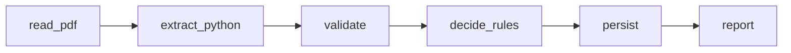
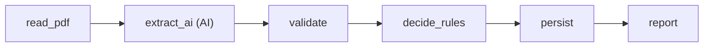
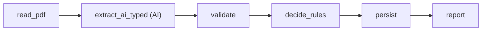
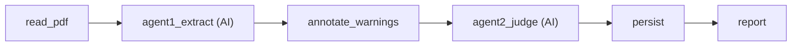

# Supplier document checker

Checks supplier quotes and contracts step by step and never guesses. For each PDF it answers
**Approve**, **Reject** or **Needs a person to check**, with the reason and the exact text it relied on.
Built for the BIAI AI Engineer Round 2, Task 1.

The steps are fixed and run one after another as a [LangGraph](https://github.com/langchain-ai/langgraph)
graph: **read PDF → extract facts → validate → decide → save → report**. Nothing runs freely.
A model only fills in an answer inside its own step, and any failure ends as "Needs a person to check".

## Results on the 10 sample PDFs

I built four approaches to learn where AI actually helps. Same PDFs, same company rules.

| | What it does | Verdicts right | Facts right (of 270) | Time for 10 PDFs |
|---|---|---|---|---|
| 1 | Python rules only, no AI | 6/10 | 267 | 0.04 s |
| 2 | One AI call extracts the facts, Python decides | 5/10 | 246 | 374 s |
| 3 | Same, with a strict output schema and prompt | 7/10 | 262 | 356 s |
| 4 | AI reads step by step, code marks warnings, a second AI judges | **9/10** | 261 | 816 s |

No approach made a wrong approval. Approach 4 costs about $0.004 per PDF with the hosted models.
Full story, failures and diagrams: [docs/roadmap.md](docs/roadmap.md).

**Read these numbers with care.** All ten PDFs were visible while building, so this is not unseen accuracy.
Part of approach 4's jump comes from a company-rule decision I made after studying packs 06 and 08
(a missing penalty clause or tax number is a reject). Pack 01 stays a person's review, on purpose.

## Run it

Python 3.11+.

```powershell
python -m pip install -r requirements.txt
python -m procurement.review                       # approach 1, all ten PDFs, no AI and no key
Invoke-Item reports/procurement-review.html        # the report
python -m unittest discover -s tests -q            # 249 tests, no model needed
```

Pick another approach or a single file:

```powershell
python -m procurement.review --approach approach4 --provider openrouter path/to/pack.pdf
python -m procurement.review --approach approach4 --provider ollama     # local qwen3:14b
python -m procurement.review --approach both                            # compare 1 and 2
```

Approaches 2 to 4 need a model service:

- **OpenRouter (hosted):** put `OPENROUTER_API_KEY` in `.env`. Optional: `OPENROUTER_MODEL` (reader),
  `OPENROUTER_JUDGE_MODEL`, `OPENROUTER_IGNORE_PROVIDERS`. This sends the document text to a third party.
- **Ollama (local):** install it, `ollama pull qwen3:14b`, use `--provider ollama`. Nothing leaves your machine.
- **Gemini (approach 2 only):** `GEMINI_API_KEY` in `.env`.

`.env` is git-ignored. Every run is saved under `reports/runs/` with the source text, the model's raw answer,
timings and tokens.

## Web demo

`web/` is a Next.js page and `api/` is a Python API (Vercel functions) that streams each step as it runs.
Visitors can paste their own OpenRouter key; it is sent for one check and never stored. A switch chooses
**Mock** (saved answers, no key, no AI) or **Live** (real run with your key).

```powershell
cd web; npm install; npm run dev        # mock mode at http://127.0.0.1:3000
```

To host it, make two Vercel projects from this repo: the repo root (Python API), and `web/` with
`API_MODE=live` and `BACKEND_ORIGIN=<the API project URL>`. Live AI needs HTTPS.

## The fixed workflow

Each approach is a straight line with no branches, no loops and no tools; a test checks this. The graphs are
defined in `procurement/workflow.py`. Boxes marked **AI** make one model call; the rest are plain code.

**Approach 1** (Python rules)



**Approach 2** (one AI call)



**Approach 3** (strict schema)



**Approach 4** (reader and judge)



The same graphs can be printed from the code: `python -m procurement.workflow --mermaid approach4`.

## How it never guesses

- Every fact carries an exact quote from the PDF. A quote that is not in the PDF is rejected.
- Each fact is `found`, `not_found`, `unrecognized` or `ambiguous`. Only `found` supplies a value.
- Money uses `Decimal`, not floats. Reject beats review, and every finding stays visible.
- A failed model call, a missing fact or a doubtful answer ends as **Needs a person to check**, never an approval.
- Document text is treated as data, never as instructions to the model.

## Human review

A pending result lists the questions, the affected facts and the PDF excerpts. A reviewer can record a
source-backed correction. It is applied to the saved extraction with no new model call, and the same rules run again:

```powershell
python -m procurement.review pack.pdf --source-run reports/runs/SAVED_RUN.json --review-response RESPONSE.json
```

The response must match the original run and the PDF hash. It cannot override a verdict or a policy.

## What does not work well

- Approach 4 is slow (about 80 s per PDF) and depends on a hosted model; a provider outage ends in review.
- The judge is an AI, so the same PDF can in principle be judged differently on another run.
- Approach 1 cannot read free-form terms (packs 01, 02, 06 and 08 need a person).
- Tables must be simple ruled grids. No OCR, no multi-item decisions, currency must be BDT, and TIN/BIN
  numbers are only checked for presence.
- The ten PDFs are also the only test set, so results are not proven on unseen documents.

## Next

Hold out unseen PDFs, add OCR and multi-item quotes, cache repeated judgements, and add rate limiting
to the public demo.

## Code map

Start at `procurement/review.py` and `procurement/workflow.py`.

| Path | Purpose |
|---|---|
| `procurement/approach1/` | Python extractors |
| `procurement/approach2/`, `approach3/` | Hosted and local AI extraction (prompt, schema) |
| `procurement/approach4/` | Reader agent, judge agent, transport |
| `procurement/shared/` | PDF reading, fact records, rules, runs, reports, human review |
| `api/`, `procurement/stream_run.py` | Streaming API for the demo |
| `web/` | Frontend |
| `config/`, `sample-data/` | Company rules, purchase request, the ten PDFs |
| `tests/` | One folder per approach plus `shared/` |

More: [docs/roadmap.md](docs/roadmap.md) (the full journey), [docs/submission-note.md](docs/submission-note.md),
[docs/sample-results.md](docs/sample-results.md), `company-rules.md` (the rules, the source of truth).
Generated reports are git-ignored.
